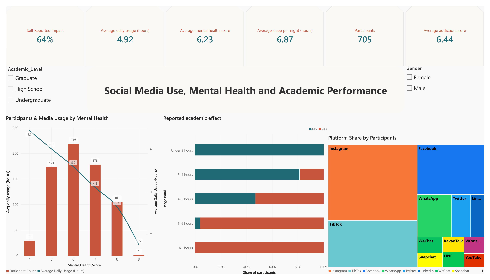
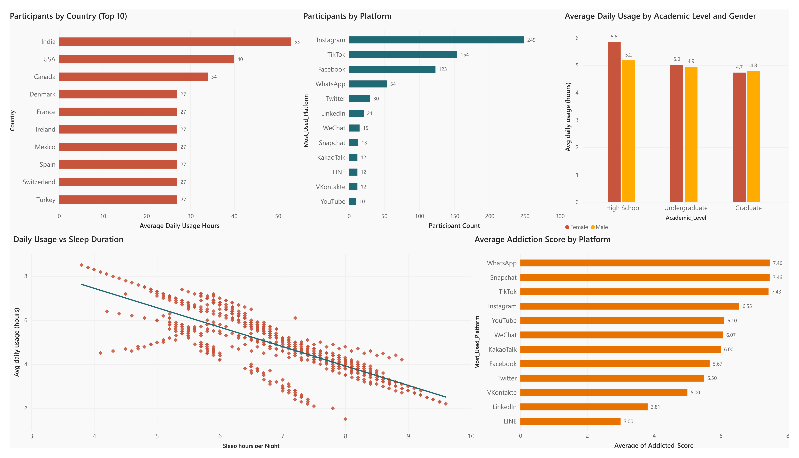

# Social Media Use, Mental Health and Academic Performance

Power BI report on how daily social media use relates to sleep, mental health score, addiction score and self-reported academic impact across 705 survey participants.




## Business question

How does daily social media use relate to sleep, mental health and academic impact, and does the pattern differ by platform, academic level and gender?

**Audience:** University Student Wellbeing and Academic Advising Services (allocating mental health outreach resources, scheduling digital wellness workshops, and targeting academic intervention programs based on student usage tiers and reported academic impacts).

**Scope:** the data is a self-reported survey. The report shows association. It does not show cause.

## Key metrics

| Metric | Value | Definition |
|---|---|---|
| Participants | 705 | Count of survey respondents |
| Average daily usage (hours) | 4.92 | Mean of `Avg_Daily_Usage_Hours` |
| Average mental health score | 6.23 | Mean of `Mental_Health_Score` (scale: 1-10) |
| Average sleep per night (hours) | 6.87 | Mean of `Sleep_Hours_Per_Night` |
| Average addiction score | 6.44 | Mean of `Addicted_Score` (scale: 1-10) |
| Self-reported impact | 64% | Share of participants answering Yes to `Affects_Academic_Performance` |

## Findings

1. **Academic impact rises with usage.** No participant using social media under 3 hours a day reports an academic impact. Every participant at 6+ hours does. Shares for the bands between are in the Reported academic effect chart: approximately 22% for 3–4 hours, 53% for 4–5 hours, and 92% for 5–6 hours reporting an impact (with non-impact shares of 78%, 47%, and 8% respectively.
2. **Usage falls as the mental health score rises.** Average daily usage is 6.9 hours at a score of 4 and 1.5 hours at a score of 9. Group sizes by score 4 to 9 are 29, 173, 219, 178, 105 and 1 participants, so the score-9 value rests on one person. On the dataset's scale, higher means better mental health.
3. **Usage falls as sleep rises.** The scatter plot and trend line show participants who sleep more report fewer usage hours. Pearson correlation reflects a strong negative relationship of approximately $r = -0.75$. 
4. **Platform mix.** Instagram has 249 participants (35.3%), TikTok 154 (21.8%) and Facebook 123 (17.4%).
5. **Addiction score by platform.** WhatsApp (7.46, 54 participants), Snapchat (7.46, 13) and TikTok (7.43, 154) have the highest averages. TikTok is the highest among platforms with more than 100 participants. LINE (3.00, 12) and LinkedIn (3.81, 21) have the lowest.
6. **Academic level and gender.** Average daily usage is 5.8 hours for female and 5.2 for male high school participants, 5.0 and 4.9 for undergraduates, and 4.7 and 4.8 for graduates.
7. **Country.** India has 53 participants, the USA 40 and Canada 34. Seven further countries have 27 each, so the country view shows participation, not usage.

## Report pages

**Overview:** six KPI cards, academic level and gender slicers, participants and average usage by mental health score (column and line), reported academic effect by usage band (100% stacked bar), platform share by participants (treemap).

**Relationships:** participants by country (top 10), participants by platform, average daily usage by academic level and gender, daily usage against sleep duration (scatter with trend line), average addiction score by platform.

### Dataset

**Source:** [Power BI Project: Social Media Impact](https://github.com/mochen862/power-bi-project-social-media-impact)

The dataset used in this project was obtained from the source repository linked above.

The source repository's dataset redistribution permissions have not been verified. To avoid redistributing data without confirmed permission, the raw dataset is not included in this repository.

Please refer to the original source for the dataset and its applicable licensing terms.

**Scope:** Findings describe patterns in the supplied dataset and should not be interpreted as evidence of causation or as conclusions about all social media users.
- **Rows:** 705
- **Fields:** `Student_ID`, `Age`, `Gender`, `Academic_Level`, `Country`, `Avg_Daily_Usage_Hours`, `Most_Used_Platform`, `Affects_Academic_Performance`, `Sleep_Hours_Per_Night`, `Mental_Health_Score`, `Relationship_Status`, `Conflicts_Over_Social_Media`, `Addicted_Score` 

## Data preparation and model

- **Power Query:** type changes, null checks.
- **Calculated column:** `Usage Band` groups daily usage into under 3, 3-4, 4-5, 5-6 and 6+ hours. `Usage Band Order` sorts the bands.
- **Measures:** `Participant Count` and `Self Reported Impact`. DAX for each is in [docs/measures.md](docs/measures.md).
- **Model:** one flat table with no relationships.

## Limitations

- Self-reported survey data. The findings describe this dataset and do not generalize.
- The score-9 group has one participant. Several platform groups have under 20 participants.
- The model is a single table with no date table, no star schema and no row-level security.
- The treemap uses a different color palette from the other charts.

## Repository structure

```
.
├── README.md
├── dashboard/
│   └── addiction-social-media-analytics-powerbi.pbix
├── data/
│   └── README.md          
├── docs/
│   └── measures.md
└── images/
    ├── overview.png
    └── relationships.png
```

## How to open

Download `dashboard/addiction-social-media-analytics-powerbi.pbix` and open it in Power BI Desktop. If the data source path breaks, update it under Transform data → Data source settings.

## Author

Mahak Sharma | [LinkedIn](https://www.linkedin.com/in/mahaksharma1/) | [GitHub](https://github.com/mahak-analytics)
